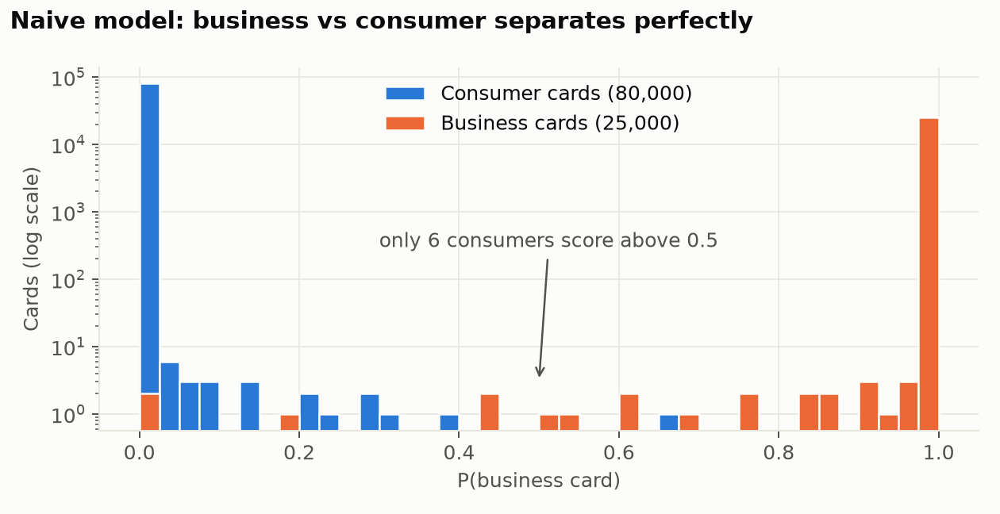
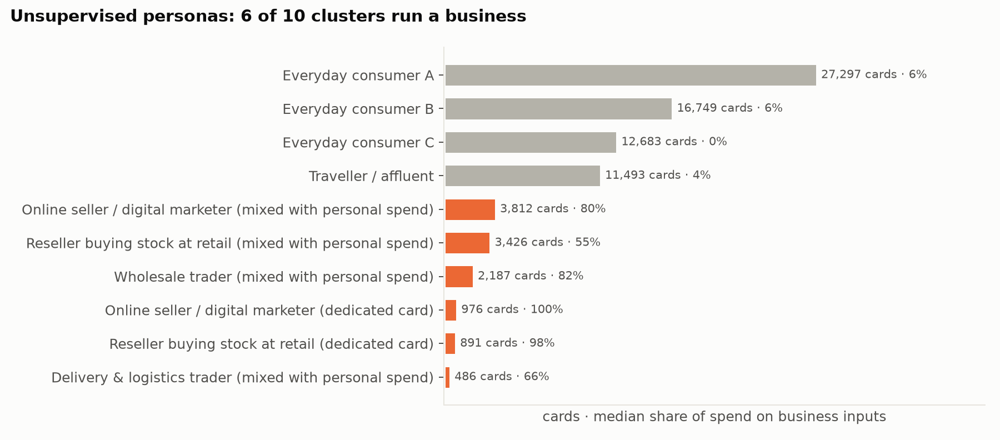
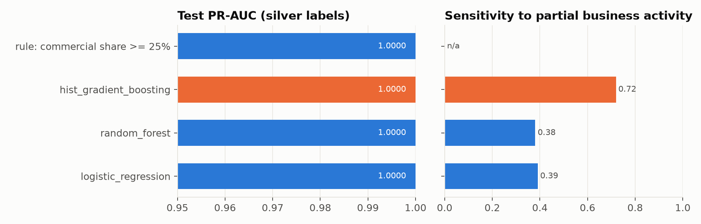
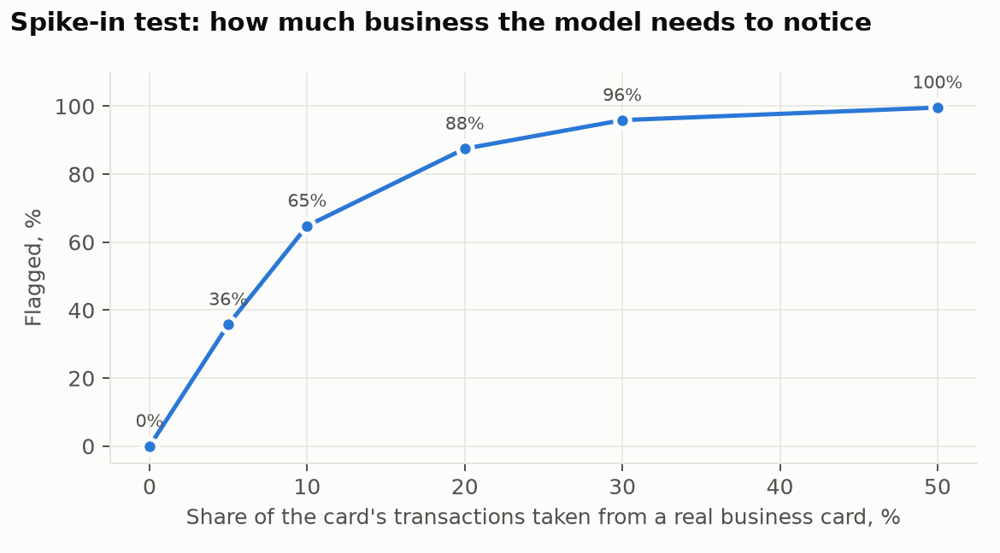
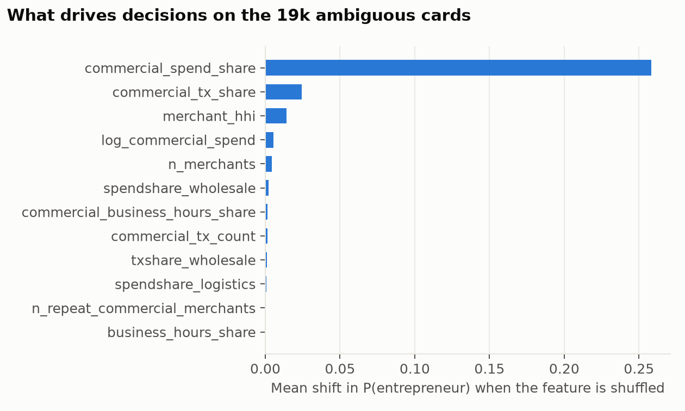
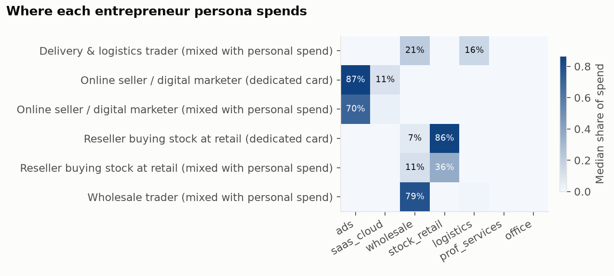

# Hidden entrepreneurs in card data

Finding people who run a business through a personal card, from 12.8 million synthetic card transactions.
Case from **Mastercard Data Quest 2026** (Mastercard Advisors × AIESEC in Almaty, May–June 2026).

**Result:** 14,440 of 80,000 consumer cards (18%) show a commercial footprint, sorted into 3 lead tiers and 6 entrepreneur personas, each with a plain-language reason per card.

| | |
|---|---|
| Task analysis and plan (RU) | [docs/task_analysis_and_plan_ru.md](docs/task_analysis_and_plan_ru.md) |
| Pipeline | [run_pipeline.py](run_pipeline.py) → [src/hidden_biz](src/hidden_biz) |
| Presentation | [presentation/hidden_entrepreneurs.pptx](presentation/hidden_entrepreneurs.pptx) |
| Metrics | [reports/metrics.json](reports/metrics.json) |

## The task

Some sole traders and self-employed people sell through ordinary consumer cards. A bank wants to find them: business tariffs earn more per transaction, and these clients need acquiring, working-capital loans and cash-register services. The brief asked for a predictive ML model that spots this hidden commercial activity "reliably and fast", plus a presentation.

Data: 25,000 business cards (3.0M transactions), 80,000 consumer cards (9.8M transactions), a reference of 2,165 merchants, October 2025 to March 2026. Nothing in the data marks a consumer as an entrepreneur.

## The trap: business vs consumer

The obvious move is PU learning: train "business card vs consumer card", then score consumers. I tried it first.



ROC-AUC 0.99999984, and the model flags **6 consumers out of 80,000**. The two card types never share a basket: business cards in this data contain zero grocery or pharmacy purchases. So the model learns what a *business card* looks like. A hidden entrepreneur buys groceries on the same card, which makes them look like a consumer.

The second problem: hidden entrepreneurs buy differently from business cards. Resellers buy stock at building-material and food stores (MCC 5211, 5499), where business cards almost never shop.

## Approach

```
raw parquet ──► cleaning ──► 49 card features ──► K-Means personas ─┐
                                    │                               ├─► silver labels ──► 3 models + search ──► champion
                                    └─────────── expert rule ───────┘    (agree only)                              │
                                                                                         4 label-free checks ◄─────┘
```

**1. Cleaning.** No duplicates, nulls or non-positive amounts. **60,851 transactions** from ad platforms (Google, Meta) carried MCC 7012 (timeshares) while the merchant master says 7311; I used the master. 12,831 transactions above the 99.9th percentile (2.26M KZT) stay in: a large purchase is normal for a business, and features use medians, quantiles and logs.

**2. Features (one row per card).** I grouped MCCs by their ISO 18245 meaning into a commercial footprint: advertising, software/cloud, wholesale, stock bought at retail, logistics, professional services, office supplies. On top: spend and purchase shares per group, suppliers used 3+ times, office-hours share, ticket size, merchant concentration (HHI), business subscriptions, foreign merchants, monthly regularity. Card tier, bank and BIN stay out of the model because they describe the product.

**3. Personas (unsupervised).** K-Means on consumer profiles, k = 10 (silhouette plus readability). Six clusters spend 55–100% of their money on business inputs. The commercial/non-commercial split stays 99.8% the same across random seeds.



**4. Silver labels (weak supervision).** I label a card only when two independent views agree:
- *Cluster view:* the card belongs to a commercial persona.
- *Rule view:* ≥ 25% of spend goes to business inputs and the card uses ≥ 2 commercial merchants repeatedly. Below 10% counts as clearly personal.

That gives 9,757 positives and 50,912 negatives. The remaining 19,331 cards are left for the model to decide.

**5. Models.** Logistic regression, random forest and histogram gradient boosting, each tuned with a 5-fold randomized search on 80% of labelled cards. The threshold maximises out-of-fold F0.5, because every false lead costs a relationship manager time.

## Results

### On the held-out 20%

| Model | CV PR-AUC | Test PR-AUC | Sensitivity to partial business* |
|---|---|---|---|
| Logistic regression | 1.000 | 1.000 | 0.39 |
| Random forest | 1.000 | 1.000 | 0.38 |
| **Gradient boosting** (champion) | 1.000 | 1.000 | **0.72** |
| Rule: commercial share ≥ 25% | | 1.000 | n/a |

\*Mean detection rate on validation hybrid cards (see spike-in below), built from training cards only.

Confusion matrix of the champion at threshold 0.61: TN 10,183 · FP 0 · FN 0 · TP 1,951.

**How to read the perfect score.** The silver labels keep only cards where both views agree, so the test set holds clear cases, and the data is synthetic with distinct personas. A perfect test score proves the model reproduces the labels. It does not prove the labels are right. The four checks below test that.



### Four checks that do not use the silver labels

| Check | Question | Result |
|---|---|---|
| Real business cards | The model never saw one. Does it recognise them? | **24,997 of 25,000** flagged (99.99%) |
| MCC-blind model | Can a model that never sees *what* is bought recover the labels from *how* (ticket, timing, merchant concentration)? | ROC-AUC 0.9995, F1 0.995 |
| Spike-in | Mix part of a real business card into an ordinary consumer card. When does the model notice? | 0% false alarms on clean cards; 36% caught at 5% business share, 65% at 10%, 88% at 20%, 96% at 30% |
| Stability in time | Score Oct–Dec and Jan–Mar separately | 93.6% of cards get the same decision; 12,712 flagged in both halves |



The MCC-blind check matters most. The labels come from *what* people buy. A model that sees only *how* they buy still finds the same people. So the personas describe real behaviour and not an artefact of my MCC dictionary.

Gradient boosting won on sensitivity: at 10–20% business activity the linear model and the forest mostly miss the card, while the champion catches 65–88%.

### What drives the decision

On the 19k ambiguous cards, the score moves most with the share of spend on business inputs, the share of purchases in business categories and merchant concentration (few suppliers, many repeat purchases).



Each flagged card gets three reasons, for example:
> *41% of spend on stock (building materials, food); 54% of purchases in business categories; 18% of spend at wholesalers*

## Who the hidden entrepreneurs are



| Persona | Cards | Signature | Offer |
|---|---|---|---|
| Online seller / digital marketer | 4,788 | Meta & Google Ads, Canva, cloud; 976 of them use the card only for business | Business card with ad-spend cashback and FX for foreign SaaS; payment links and e-commerce acquiring |
| Reseller buying stock at retail | 4,317 | building materials and food bought in bulk in office hours, few suppliers, median ticket 30–106k KZT | QR/POS acquiring, inventory loan, help registering as a sole trader (IP) |
| Wholesale trader | 2,187 | 79% of spend at wholesalers | Credit line, corporate card, payroll project as the business grows |
| Delivery & logistics trader | 486 | couriers, freight, wholesale | Fleet/fuel card, acquiring |

Counts are cluster sizes; 2,723 more flagged cards sit inside ordinary personas and land in the "likely" and "watchlist" tiers.

### Lead tiers

| Tier | Rule | Cards | Commercial spend, KZT/year |
|---|---|---|---|
| 1 · confirmed | model + cluster + rule agree | 9,757 | 199.0 bn |
| 2 · likely | model + one of the two views | 3,199 | 32.5 bn |
| 3 · watchlist | model only | 1,484 | 3.6 bn |

Tiers 1–2 move 231.5 bn KZT a year through personal cards on business inputs (6 months × 2). With *illustrative* assumptions of 15% conversion and +1 pp revenue on that spend once it moves to a business tariff, the bank gains about **347M KZT a year**. Replace both numbers with the bank's own before using this figure.

### Speed

Feature building for 12.8M transactions takes about 35 seconds on a laptop; scoring 80,000 cards takes 0.3 seconds. The full pipeline, including the hyper-parameter search and every validation step, runs in about 8 minutes.

## Limitations

- **Synthetic data.** The personas are cleaner than real life, hence the near-perfect scores. Expect lower numbers on real data.
- **Silver labels are mine.** They come from a cluster model and a rule I wrote. The checks above reduce this risk, but only a pilot with real outcomes removes it.
- **Spend side only.** The brief describes people who *receive* payments from many counterparties. The data holds only outgoing card spend. Incoming P2P transfers (Kaspi, bank transfers) would be the strongest next feature.
- **Expert MCC dictionary.** The commercial groups follow ISO 18245 meaning and my judgement; a bank's product team should review them.
- **Ethics.** Use the score to offer a better product, never to report clients or reprice them without consent.

## Next steps

1. Pilot: relationship managers call a random sample from each tier, outcomes become real labels, retrain.
2. Add inflow features: count of distinct senders, regularity of incoming transfers.
3. Re-score monthly; watch feature drift and persona sizes.

## Run it

```bash
python -m venv .venv && source .venv/bin/activate
pip install -r requirements.txt
python run_pipeline.py                # add --fast for a quicker run
python presentation/build_deck.py     # rebuilds the .pptx from reports/
pytest                                # unit tests
```

Put the three case files (`business_cards_MDQ.parquet`, `consumer_cards_MDQ.parquet`, `merchants_reference.parquet`, ~200 MB) into `data/raw/` first; `python scripts/check_data.py` confirms they are in place. Python 3.11+. Outputs go to `reports/`: `metrics.json`, `model_comparison.csv`, `personas.csv`, `spike_in.csv`, `feature_importance.csv`, `figures/`, and the full flagged list `flagged_consumers.csv` with masked card numbers (not committed; see `flagged_consumers_sample.csv` for 20 cards per tier).

## Repository layout

```
run_pipeline.py              end-to-end pipeline, one command
src/hidden_biz/
  config.py                  paths, MCC groups (ISO 18245), constants
  data.py                    loading, validation, cleaning
  features.py                card-level features and feature sets
  labeling.py                personas (K-Means) and silver labels
  modeling.py                model zoo, search, threshold, metrics
  validation.py              business-card, spike-in and stability checks
  explain.py                 importance and per-card reasons
  plots.py                   figures
presentation/build_deck.py   PowerPoint built from reports/
scripts/check_data.py        checks the case files are in data/raw/
tests/                       unit tests on a hand-made dataset
docs/                        task analysis and plan (RU)
```

The case data is synthetic and belongs to the competition organisers; it is not included here.
